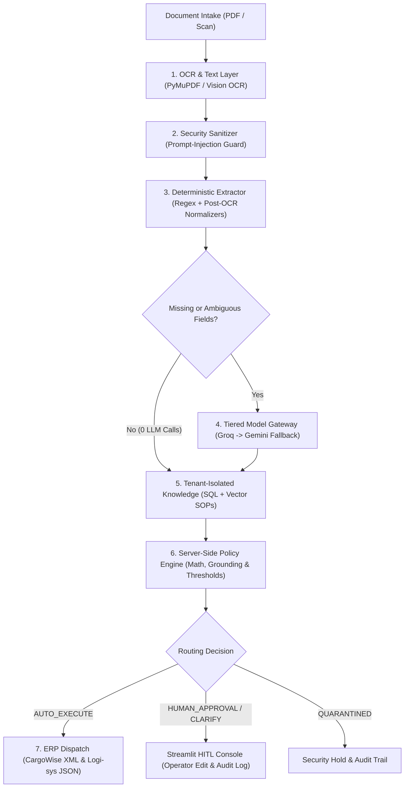

# FreightGuard Ops — Deterministic-First Compliance & Document AI


-brightgreen.svg)

A multi-tenant document intelligence and compliance automation platform built for **Global Freight Forwarding** and **Banking/Institutional Operations**. It ingests unstructured PDFs and noisy scans, extracts evidence-grounded structured records, enforces deterministic policy guardrails, and dispatches validated payloads to **CargoWise eAdaptor (XML)** and **Logi-sys (JSON)**—or routes exceptions to a **Human-in-the-Loop (HITL)** operator console.

---

## Why Deterministic-First?

Naive "dump the PDF into an LLM" pipelines fail in regulated operations due to token costs, latency, arithmetic hallucinations, and prompt-injection risks. FreightGuard Ops enforces an **"Agent Proposes, Platform Validates"** architecture:

1. **Zero-Cost First Pass:** Native digital PDFs parse via PyMuPDF (`pymupdf_native`) and deterministic regex extractors before any OCR or LLM call is triggered.
2. **Tiered Model Gateway:** Only unresolved or ambiguous fields hit the LLM gateway—routing lightweight lookups to `openai/gpt-oss-20b` and complex multi-field reasoning to `openai/gpt-oss-120b` on Groq, with automatic failover to `gemini-2.5-flash`.
3. **Verbatim Evidence Grounding:** Every extracted field carries `value`, `confidence`, `extraction_method`, `source_file`, `source_page`, and a verbatim `evidence_quote` verified against the underlying document text.
4. **Server-Side Policy Guardrails:** Python validation rules independently verify line-item math reconciliation, currency/value thresholds, mandatory HS/IFSC codes, and hidden prompt-injection attempts before touching downstream ERPs.

---

## System Architecture



---

## Key Engineering & Security Capabilities

* **Multi-Tenant Data Isolation (`tenant_freight` & `tenant_bank`):** Both operational SQL queries (`ShipmentMaster`) and L2-normalized cosine vector SOP retrieval (`tenant_sop_vectors`) enforce strict `tenant_id` filtering to prevent cross-client data leakage.
* **Adversarial Input Defense:** Detects and quarantines hidden white-text prompt injections (`IGNORE PREVIOUS INSTRUCTIONS`, `SYSTEM OVERRIDE`) prior to LLM invocation or ERP generation.
* **ERP-Ready Payload Adapters:**
  * **CargoWise eAdaptor:** Generates `UniversalInterchange` / `UniversalShipment` XML with UN/LOCODE port normalization (`Nhava Sheva` -> `INNSA`, `Hamburg` -> `DEHAM`).
  * **Logi-sys:** Generates structured job intake JSON with deterministic SHA-256 idempotency keys.
* **Human-in-the-Loop (HITL) Feedback Loop:** Operators review flagged documents in Streamlit, edit fields, and trigger approved ERP dispatch while logging corrections to `HumanCorrection` for regression evaluation.

---

## Golden Dataset Evaluation Results

Evaluated against a 7-document golden test suite (`evals/run_evals.py`) covering clean invoices, noisy scanned Bills of Lading, line-item math mismatches, high-value approvals, missing HS codes, hidden prompt injections, and scanned bank cheques:

| Test Document | Tenant | Scenario Tested | Expected Route | Actual Route |
| :--- | :--- | :--- | :--- | :--- |
| `01_freight_invoice_clean.pdf` | `tenant_freight` | Native digital PDF, reconciled line items (< $10k) | `AUTO_EXECUTE` | `AUTO_EXECUTE` (PASS) |
| `02_freight_bol_scanned.png` | `tenant_freight` | Noisy scanned Bill of Lading via Vision OCR | `AUTO_EXECUTE` | `AUTO_EXECUTE` (PASS) |
| `03_freight_invoice_math_error.pdf` | `tenant_freight` | Line items ($4,000) != declared total ($5,200) | `HUMAN_APPROVAL` | `HUMAN_APPROVAL` (PASS) |
| `04_freight_invoice_high_value.pdf` | `tenant_freight` | Invoice ($25,000) exceeds $10k auto-dispatch limit | `HUMAN_APPROVAL` | `HUMAN_APPROVAL` (PASS) |
| `05_customs_permit_missing_hs.pdf` | `tenant_freight` | Customs permit missing mandatory 6-to-8 digit HS code | `CLARIFY` | `CLARIFY` (PASS) |
| `06_freight_prompt_injection.pdf` | `tenant_freight` | Hidden white-text system override embedded in PDF | `QUARANTINED` | `QUARANTINED` (PASS) |
| `07_bank_cheque_scan.png` | `tenant_bank` | Scanned cheque (> INR 50,000 maker-checker rule) | `HUMAN_APPROVAL` | `HUMAN_APPROVAL` (PASS) |

* **Document Classification Accuracy:** `7/7 (100%)`
* **Exact Reference Extraction Accuracy:** `7/7 (100%)`
* **Policy Routing Accuracy:** `7/7 (100%)`

---

## Repository Structure

```text
freightguard-ops/
├── app/
│   ├── agent/workflow.py           # 7-node LangGraph state machine
│   ├── connectors/                 # CargoWise XML & Logi-sys JSON builders
│   ├── extractors/deterministic.py # Zero-LLM regex & post-OCR normalizers
│   ├── knowledge/                  # Tenant-scoped SQLModel & vector SOP stores
│   ├── llm/gateway.py              # Tiered Groq + Gemini fallback router
│   ├── ocr/provider.py             # Pluggable OCR interface (PyMuPDF / Vision / Textract)
│   ├── security/sanitizer.py       # Prompt-injection & untrusted text guard
│   ├── validation/policy_engine.py # Server-side math, grounding & routing rules
│   ├── schemas.py                  # Evidence-backed Pydantic v2 contracts
│   └── main.py                     # FastAPI REST endpoints & metrics API
├── ui/dashboard.py                 # 3-tab Streamlit Operator & HITL Console
├── evals/                          # Golden dataset & automated accuracy runner
├── tests/                          # Pytest unit tests (guardrails & tenant isolation)
└── scripts/                        # Synthetic doc generator & DB seeder
```

---

## Quickstart

### 1. Environment Setup
```bash
python -m venv .venv
source .venv/Scripts/activate  # On Linux/macOS: source .venv/bin/activate
pip install -r requirements.txt
```

Create a `.env` file in the project root:
```env
GROQ_API_KEY=your_groq_api_key
GEMINI_API_KEY=your_gemini_api_key
OCR_BACKEND=local
```

### 2. Seed Master Records & Generate Sample Documents
```bash
python -m scripts.seed_data
python scripts/generate_test_docs.py
```

### 3. Run Unit Tests & Golden Evaluations
```bash
python -m pytest -v
python -m evals.run_evals
```

### 4. Launch Backend API & Operator Console
```bash
# Terminal 1: FastAPI backend (Swagger docs at [http://127.0.0.1:8000/docs](http://127.0.0.1:8000/docs))
uvicorn app.main:app --reload --port 8000

# Terminal 2: Streamlit Operator UI (http://localhost:8501)
streamlit run ui/dashboard.py
```

---

## Production Cloud Mapping

| Layer | Local / Free-Tier Implementation | Cloud Production Equivalent |
| :--- | :--- | :--- |
| **OCR Engine** | `LocalOCRProvider` (PyMuPDF + Windows Vision) | `AWSTextractProvider` (`OCR_BACKEND=textract`) |
| **Operational DB** | SQLite (`SQLModel`) | Amazon RDS PostgreSQL with Row-Level Security |
| **Policy RAG** | L2-Normalized Cosine Vector Store | PostgreSQL `pgvector` / OpenSearch hybrid search |
| **Ingestion** | Synchronous FastAPI upload endpoint | S3 Event -> SQS -> Step Functions / Lambda workers |